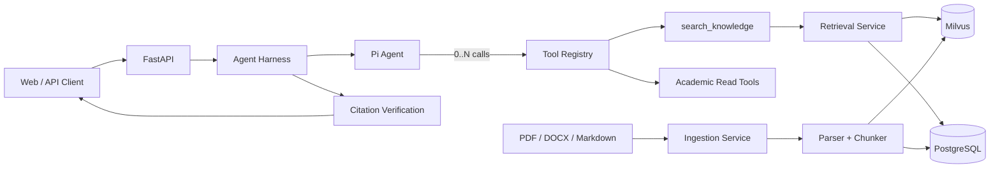

# QArag

面向中文问答场景的多语言科研知识库与 Agent 服务。系统接收 PDF、DOCX 和 Markdown 文档，以 PostgreSQL 保存权威数据，以 Milvus 提供 BGE-M3 稠密向量与 BM25 稀疏检索，通过 RRF 融合、BGE 重排、证据校验和受控拒答生成可追溯答案。

**技术栈**：Python 3.11+ · FastAPI · LangGraph · PostgreSQL · Milvus · BGE-M3 · BGE-Reranker · Docker Compose

## 核心能力

- 中文提问检索中文、英文及中英混合文档
- PDF、DOCX、Markdown 解析与结构感知分块
- 扫描 PDF 本地 OCR、混合文档逐页检测、置信度过滤与页码追溯
- BGE-M3 稠密召回与 Milvus BM25 稀疏召回
- RRF 融合、跨语言查询扩展和 BGE cross-encoder 重排
- 文档标题、章节路径、页码和原文引用追溯
- Pi Agent 0 至多次 Tool Calling 循环
- 无有效证据时拒答，拒答结果不附带无关引用
- PostgreSQL 持久化会话历史、摄取任务和业务状态
- 同步摄取与基于租约、重试的异步 Worker
- JSON 与 SSE 两种问答响应方式
- Web 管理界面、健康检查、就绪检查和结构化日志

## 系统架构



PostgreSQL 保存文档、Chunk 正文、会话、任务和 Agent 状态。Milvus 保存可重建的稠密向量、BM25 稀疏表示及检索字段。检索命中后按 Chunk ID 回 PostgreSQL 读取权威正文。

## 已验证的 RAG 流程

### 文档摄取

```text
Upload API
  → 文件名清理、大小限制、SHA-256 幂等校验
  → PDF / DOCX / Markdown 解析
  → DocNode 文档树
  → 版面清洗与结构感知分块
  → BGE-M3 向量化
  → PostgreSQL 写入权威正文
  → Milvus 写入 dense + sparse 检索数据
  → 文档状态 ready
```

1. `POST /api/v1/documents` 接收文件；`sync=true` 在请求内完成摄取，`sync=false` 写入 PostgreSQL 任务表。
2. PDF 解析器按版面恢复双栏阅读顺序，处理英文空格、断词、重复页眉页脚、页码和表格边界。
3. 解析结果转换为保留标题层级、页码和字符位置的 `DocNode` 树。
4. 分块按章节边界执行，目标长度 256 tokens、上限 384 tokens、重叠 48 tokens；父块上限 1024 tokens。
5. 嵌入文本包含文档标题与章节路径，降低跨文档同义段落的区分难度。
6. PostgreSQL 与 Milvus 写入完成后，文档状态更新为 `ready`。
7. 异步 Worker 使用 `FOR UPDATE SKIP LOCKED` 原子领取任务；失败任务按最大次数重试，租约过期后可由其他 Worker 接管。

### 扫描 PDF

```text
PDF Page
  → 文本层与页面图像检测
  → 原生文本页：pdfplumber
  → 扫描页：限像素渲染 → RapidOCR / ONNX Runtime → 文本框与置信度
  → 双栏阅读顺序恢复
  → DocNode（原始页码、bbox、extraction_method）
  → 结构感知分块
  → 现有 PostgreSQL / Milvus / Agent 链路
```

OCR 支持中文和英文印刷体，按页保留原生文本，过滤低置信文本框，并检测空白扫描页。缺少模型、识别失败、质量不足或超过处理上限时，文档状态为 `needs_ocr`，上传接口返回 HTTP 422。原生文本与 OCR 文本分别分块。

```bash
uv sync --extra dev --extra ocr
uv run --extra ocr python scripts/setup_ocr.py
uv run --extra dev --extra ocr python eval/smoke_scanned_pdf.py
```

检索结果与引用增加 `extraction_method`、`ocr_confidence`；文档详情增加 `ocr_pages`、`parse_warnings`。已有 API 路径保持不变。配置、容器部署、重新摄取与验收见 [扫描 PDF 处理手册](docs/SCANNED_PDF.md)。

### 混合检索

```text
Query
  → 多轮上下文改写
  → 中英文查询扩展
  → Dense Top-50 ─┐
                   ├→ RRF Top-60
  → BM25 Top-50 ──┘
  → 保留各召回通道头部候选
  → BGE-Reranker-v2-M3
  → 元数据与参考文献排序修正
  → 多文档问题的文档多样化
  → PostgreSQL 回表
  → 去重与邻接上下文扩展
  → Final Top-5
```

1. 会话问题先结合裁剪后的历史消息完成独立化改写。
2. 中文问题面对英文候选时生成跨语言查询表达；原始查询始终保留。
3. Dense 和 BM25 两路并行召回，默认各取 50 条。
4. RRF 只按名次融合异构分数，默认保留 60 条候选，并保留单路强命中结果。
5. 重排输入包含查询、文档标题、章节路径和正文；候选在同一批次内比较。
6. 普通内容问题降低参考文献与题名页元数据排序；作者和文献信息问题保留元数据优先级。
7. 明确要求比较多份文档时增加来源多样性。
8. 最终结果回 PostgreSQL 读取正文，并输出来源、页码、章节和各阶段诊断字段。

### Agent 问答

```text
POST /api/v1/chat
  → AgentHarness.run()
  → Pi Agent: Observe / Decide
  → 无需知识库：直接回答
  → 需要知识库：search_knowledge(query)
      → 现有 Retrieval Service
      → 结构化 Tool Result
  → Agent 再判断
  → 继续调用 Tool 或生成答案
  → 引用逐字校验
  → Answer / Refuse
```

`AgentHarness` 统一管理 Agent 初始化、Tool 注册、上下文注入、超时、异常映射和最多 8 次迭代。`search_knowledge(query)` 只返回检索证据，不生成最终答案。最终答案由 Agent 基于 Tool Result 生成，并使用 `[n]` 标注来源。

会话历史保存在 PostgreSQL `messages` 表中，只向模型回传用户问题与最终答案。检索块、诊断信息和中间状态不进入长期对话历史。涉及结构化任务时，Task State 与自然语言历史分别维护。

### 引用与拒答

- 每条引用绑定 `chunk_id`、文档标题、章节路径、页码与原文摘录。
- 服务端逐字检查引用摘录是否存在于声明的源 Chunk。
- 检索证据不足、冲突未解决或知识库不存在答案时返回拒答。
- 拒答响应的 `citations` 固定为空，防止无关召回被展示为答案依据。
- 回答响应包含 `verified`、`route`、`grade_reason`、`retries` 和检索诊断。

## 评测结果

评测集包含 30 条单跳问题、10 条多跳问题和 10 条不可回答问题。检索指标统计 40 条可回答问题，检索深度为 Top-10。最终配置启用跨语言扩展、Dense、BM25、RRF 和 Reranker。

| 指标 | 最初基线 | 当前结果 |
|---|---:|---:|
| Chunk Recall@1 | 0.150 | **0.550** |
| Chunk Recall@5 | 0.500 | **0.950** |
| Chunk Recall@10 | 0.625 | **0.950** |
| Chunk MRR | 0.306 | **0.729** |
| Document Recall@1 | — | **0.925** |
| Document Recall@5 | 0.950 | **1.000** |
| Document MRR | 0.772 | **0.956** |
| 不可回答问题拒答准确率 | — | **1.000（10/10）** |
| 可回答问题错误拒答率 | — | **0.050（2/40）** |
| 引用逐字一致率 | — | **1.000（113/113）** |

### 消融结果

| 配置 | Chunk R@1 | Chunk R@5 | Chunk R@10 | Chunk MRR | Doc R@5 |
|---|---:|---:|---:|---:|---:|
| Full | **0.550** | **0.950** | 0.950 | **0.729** | **1.000** |
| - Translate | 0.525 | 0.900 | **0.975** | 0.689 | **1.000** |
| - Rerank | 0.300 | 0.725 | 0.775 | 0.507 | 0.975 |
| - Dense | 0.500 | 0.825 | 0.850 | 0.653 | **1.000** |
| - Sparse | 0.500 | 0.925 | 0.925 | 0.694 | **1.000** |
| Dense Only | 0.400 | 0.825 | 0.850 | 0.580 | 0.975 |
| Sparse Only | 0.200 | 0.600 | 0.750 | 0.372 | 0.925 |

机器可读结果：

- `eval/results/retrieval_v3_final.json`
- `eval/results/chat_v3_multiturn_fix.json`
- `eval/results/report.md`

完整升级记录见 [召回率审计与升级记录](docs/RETRIEVAL_AUDIT.md)。

## API

| Method | Path | 功能 |
|---|---|---|
| `GET` | `/healthz` | 进程存活状态 |
| `GET` | `/readyz` | PostgreSQL、Milvus、模型与 Checkpointer 就绪状态 |
| `POST` | `/api/v1/documents` | 同步或异步摄取文档 |
| `GET` | `/api/v1/documents` | 文档列表 |
| `GET` | `/api/v1/documents/{document_id}` | 文档详情 |
| `DELETE` | `/api/v1/documents/{document_id}` | 软删除文档及检索数据 |
| `GET` | `/api/v1/jobs/{job_id}` | 异步摄取任务状态 |
| `POST` | `/api/v1/retrieve` | 检索与消融开关 |
| `POST` | `/api/v1/chat` | Agent 问答，支持 JSON 与 SSE |

### 检索请求

```bash
curl -X POST http://127.0.0.1:8000/api/v1/retrieve \
  -H "Content-Type: application/json" \
  -d '{
    "query": "这组实验的主要结论是什么？",
    "top_k": 5,
    "use_dense": true,
    "use_sparse": true,
    "use_rerank": true,
    "use_translate": true
  }'
```

### Agent 问答请求

```bash
curl -X POST http://127.0.0.1:8000/api/v1/chat \
  -H "Content-Type: application/json" \
  -d '{
    "question": "比较两篇文档的方法与实验结论，并给出来源。",
    "thread_id": "research-session-001",
    "top_k": 5,
    "stream": false
  }'
```

### SSE 问答请求

```bash
curl -N -X POST http://127.0.0.1:8000/api/v1/chat \
  -H "Content-Type: application/json" \
  -d '{
    "question": "总结文档中的研究限制。",
    "thread_id": "research-session-001",
    "stream": true
  }'
```

SSE 事件顺序为 `start`、`citations`、`delta`、`done`；异常时返回 `error`。

## 部署

### Docker Compose

```bash
cp .env.example .env
docker compose up -d --build
curl http://127.0.0.1:8000/healthz
curl http://127.0.0.1:8000/readyz
```

默认启动 PostgreSQL、Milvus、API 和 Worker。模型目录通过只读卷挂载：

```text
models/
├── bge-m3/
└── bge-reranker-v2-m3/
```

启用独立模型服务：

```bash
docker compose --profile models up -d --build
```

启用 Neo4j：

```bash
docker compose --profile graph up -d --build
```

PostgreSQL、Milvus、模型服务和 Neo4j 的宿主机端口均绑定至 `127.0.0.1`。外部访问由反向代理统一接入。

### 本地运行

```bash
uv venv --system-site-packages .venv
uv sync --extra dev
cp .env.example .env

python scripts/run_api.py --port 8000
python -m rag.worker
```

Windows 使用 `scripts/run_api.py` 设置与 psycopg async 兼容的事件循环。Linux 可直接启动：

```bash
uvicorn rag.main:app --host 0.0.0.0 --port 8000
```

Web 界面地址：`http://127.0.0.1:8000/`

完整部署步骤见 [部署手册](docs/DEPLOY.md)。

## 配置

| 配置 | 默认值 | 作用 |
|---|---|---|
| `REPOSITORY_BACKEND` | `postgres` | 权威数据与任务仓储 |
| `MILVUS_COLLECTION` | `rag_chunks` | 正式读取的向量集合 |
| `EMBED_PROVIDER` | `local` | `local`、`api` 或 `none` |
| `EMBED_MODEL_ID` | `BAAI/bge-m3` | 稠密嵌入模型 |
| `RERANK_PROVIDER` | `none` | 本地或 API 重排服务 |
| `RERANK_API_MODEL` | `BAAI/bge-reranker-v2-m3` | 重排模型 |
| `LLM_PROVIDER` | `none` | OpenAI 兼容生成服务 |
| `CHUNK_TARGET_TOKENS` | `256` | 目标 Chunk 长度 |
| `CHUNK_MAX_TOKENS` | `384` | Chunk 最大长度 |
| `CHUNK_OVERLAP_TOKENS` | `48` | 相邻 Chunk 重叠 |
| `RETRIEVE_DENSE_TOP_K` | `50` | Dense 候选数 |
| `RETRIEVE_SPARSE_TOP_K` | `50` | BM25 候选数 |
| `RETRIEVE_FUSED_TOP_K` | `60` | RRF 后候选数 |
| `RETRIEVE_FINAL_TOP_K` | `5` | 最终证据数 |
| `RRF_K` | `60` | RRF 常数 |
| `AGENT_MAX_ITERATIONS` | `8` | 单轮最大 Tool Loop 次数 |
| `AGENT_TOOL_TIMEOUT_SECONDS` | `120` | Tool 调用超时 |

完整配置项见 [.env.example](.env.example)。

## 测试与验收

```bash
uv sync --extra dev
uv run pytest
uv run ruff check .
python scripts/smoke_local.py
```

测试覆盖：

- 问候场景 0 次 RAG Tool 调用
- 知识问题 1 次 RAG Tool 调用
- 多步骤任务多次 Tool 调用
- 知识库无答案时受控拒答
- Tool 超时、失败与最大迭代保护
- 多轮历史加载与线程隔离
- Task State 更新、冲突检测与恢复
- 结构化检索结果和引用字段

Worker 与基础设施验收：

```bash
python scripts/smoke_worker.py
python scripts/smoke_worker_pg.py
python scripts/smoke_milvus_lite.py
```

## 数据一致性与恢复

- PostgreSQL 是文档正文、会话、任务和业务状态的权威存储。
- Milvus 是可按 PostgreSQL 数据重建的检索读模型。
- 文档以内容 SHA-256 作为摄取幂等键。
- Chunk 与文档软删除状态在 PostgreSQL 回表时再次过滤。
- Worker 通过数据库行锁领取任务，通过租约恢复异常中断任务。
- 新索引使用新集合离线构建，验证通过后切换 `MILVUS_COLLECTION`。
- 回滚通过恢复上一集合名称并重启 API 与 Worker 完成。

## 项目结构

```text
src/rag/
├── agent/       Pi Agent、Tools、Harness、Prompts、Task State、LangGraph
├── api/         FastAPI 路由、Pydantic 契约、Web 静态资源
├── chunking/    结构感知分块与 token 计数
├── core/        配置、日志、错误类型、事件循环
├── infra/       PostgreSQL、Milvus、仓储与读模型
├── parsers/     PDF、DOCX、Markdown 与表格解析
├── providers/   Embedding、Reranker、LLM 的 local/api/none 实现
├── schemas/     DocNode、Chunk、Citation 数据结构
├── services/    摄取、检索、融合、翻译和结构化查询
└── worker/      PostgreSQL 异步摄取消费者
eval/            评测集、评测脚本与机器可读结果
scripts/         启动、重建索引、推理服务与 Smoke Test
tests/           Agent V1/V2 回归测试
```

## Roadmap

### P0：发布基线

- [ ] 接入认证与租户授权，由服务端注入用户身份和数据范围
- [ ] 使用 Alembic 管理文档、会话、任务和业务表迁移
- [ ] 将 SSE 升级为模型 Token 与 Tool Event 原生流式输出
- [ ] 接入 OpenTelemetry Trace、Prometheus 指标与告警规则
- [ ] 增加 API 限流、请求幂等键和审计事件
- [ ] 建立 PostgreSQL、Milvus 的自动备份与恢复演练

### P1：通用科研问答

- [ ] 建立覆盖医学、生命科学、计算机、工程、法学和人文的独立评测集
- [x] 扫描 PDF OCR、混合文档逐页检测与页码追溯
- [ ] 扩展低清、手写、复杂旋转扫描件的独立评测
- [ ] 增加公式、图注和复杂表格语义抽取
- [ ] 增加 Claim 级证据蕴含校验与冲突证据展示
- [ ] 按语言和学科校准 Reranker 阈值与拒答阈值
- [ ] 增加 DOI、作者、机构和参考文献的规范化与去重
- [ ] 增加跨文档研究方法、数据集与结论对齐

### P2：稳定性与规模

- [ ] 完成并发摄取、长文档问答和多轮会话负载测试
- [ ] 增加 Worker 卡死检测、死信任务和人工重放入口
- [ ] 增加向量集合版本注册、灰度切换与自动回滚
- [ ] 增加检索漂移、索引新鲜度和引用失败率监控
- [ ] 在单 Agent 指标稳定后引入 Supervisor/Worker 协作模式

## 项目文档

| 文档 | 内容 |
|---|---|
| [召回率审计与升级记录](docs/RETRIEVAL_AUDIT.md) | 解析、分块、跨语言、融合、重排、拒答与评测结果 |
| [部署手册](docs/DEPLOY.md) | 本地、Docker、GPU 推理服务、运维与故障恢复 |
| [扫描 PDF 处理手册](docs/SCANNED_PDF.md) | OCR 安装、逐页处理、置信度、故障状态与验收 |
| [系统架构](docs/ARCHITECTURE.md) | 组件职责、数据流和存储边界 |
| [Agent V1](docs/AGENT_V1.md) | RAG Tool、最小循环与 Harness |
| [Agent V2](docs/AGENT_V2.md) | 多 Tool Loop、Task State 与多轮任务 |
